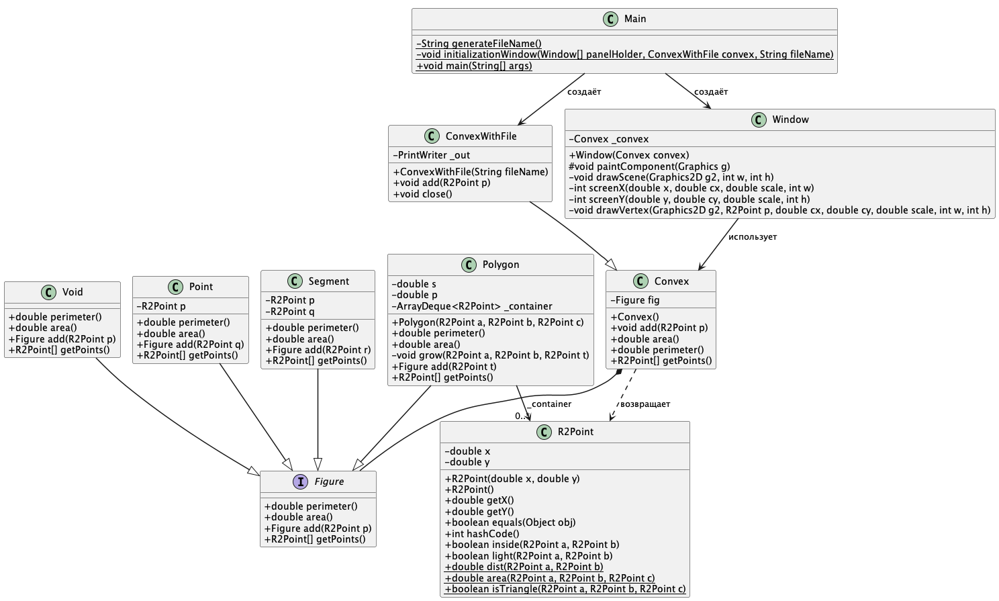

# Задание 20. Выпуклая оболочка --- 1

## Формулировка задания

Модифицируйте код проекта «Выпуклая оболочка» так, чтобы:

1. В отдельном окне после ввода очередной точки визуализировалось актуальное
состояние выпуклой оболочки. [x]
2. Все вводимые точки записывались в текстовый файл. [x]
3. Вместо метода equal в классе R2Point использовался переопределенный метод equals
класса Object. [x]

4. Вместо класса Deq.java использовался шаблон java.util.ArrayDeque<E>. [x]

5. Посредством двойной буферизации был устранен эффект «мерцания» экрана при
перерисовки выпуклой оболочки. [x]

```java
@Override
public void paint(Graphics g){
    super.paint(g);
    //g.clearRect(-width/2, height/2, width, height); //очистка экрана, если нет буферизации
    BufferedImage bufferedImage = new BufferedImage(width, height,
    BufferedImage.TYPE_INT_ARGB);
    Graphics g2 = bufferedImage.createGraphics(); //или Graphics2D
    //отрисовка выпуклой оболочки и осей координат в g2 (а не в g)
    //Graphics2D g2d = (Graphics2D)g;
    g.drawImage(bufferedImage, 0, 0, null); //или в g2d
}
```

6. Для модифицированной версии проекта постройте диаграмму классов. [x]



## Отчет по заданию

### Список проделанных действий

- Переписал класс Polygon под java.util.ArrayDeque<E>, использовал аналогичные методы. Потребовалось использовать вложенность ArrayDeque как фасад, тк интерфейс Figure и класс ArrayDeque<E> имели одинаковый метод. (4)

- Переписал способ сравнения точек. Использовал его из класса Object + добавил hashCode. (3)

- Унаследовал от класса Convex класс ConvexWithFile, в нем реализовал механихм сохранения точек в файл. (2)

- Реализовал графику с двойной буферизации. (1) (5)

- С использованием .puml формата, написал и сгенерировал Диаграмму классов. (6)