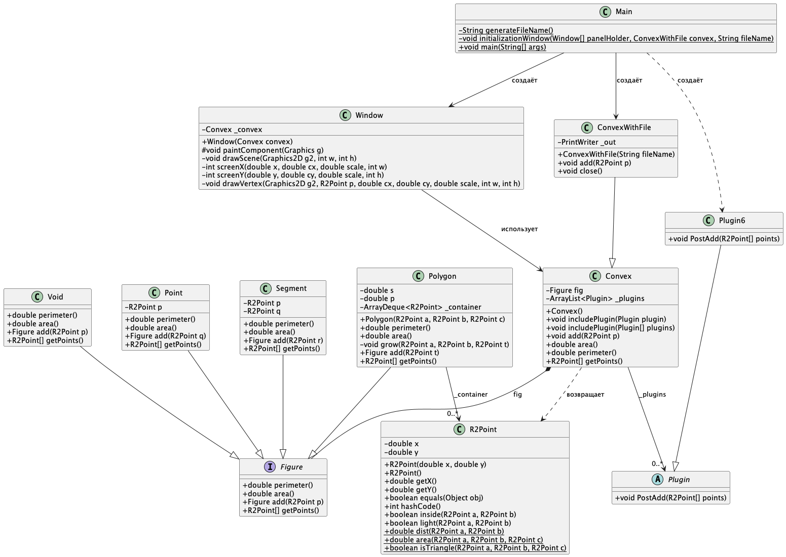

# Задание 21. Выпуклая оболочка --- 2

## Формулировка задания

Модифицируйте код проекта «Выпуклая оболочка» так, чтобы программа индуктивно (!) вычисляла:

Выбран вариант (6)

6. угол между максимальным и минимальным по длине ребрами выпуклой оболочки; [x]

## Отчет по заданию

### Список проделанных действий

- Написал абстрактный класс - Plugin.

- На базе Plugin написал класс Plugin6, который реализует требования задания.

- В классе Convex создал методы (Convex::includePlugin) включения плагинов, а также поле списка плагинов (Convex::_plugins).

- В методе добавления точки (Convex::add) реализовал перечисление исполнения методов (Plugin::PostAdd) плагинов.

- Обновил диаграмму классов.

